# Redesigned dictionaries: snapshots

512 × 512, the page's default settings, seed 1, turns 200 / 1000 / 3000. Raw frames in the page's colouring (byte palette, stretched around the previous frame's mean), without the page's render buffer. `sheet.png` holds all of them. Numbers: block change, the share of 8 × 8 blocks in the settled part (rows from 60 % down) whose most common content differs from 360 turns before. Write-up: `../../results/redesign.md`.

| dictionary | turn 200 | turn 1000 | turn 3000 | block change at 1000 / 2000 / 3000 (256², seed 2, at 3000) |
|---|---|---|---|---|
| Three phases chasing (`ca-live-phases`) | 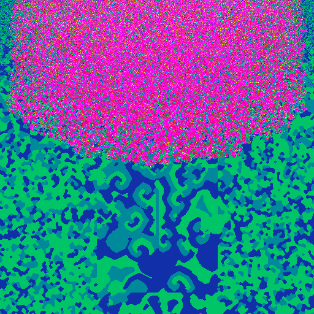 | 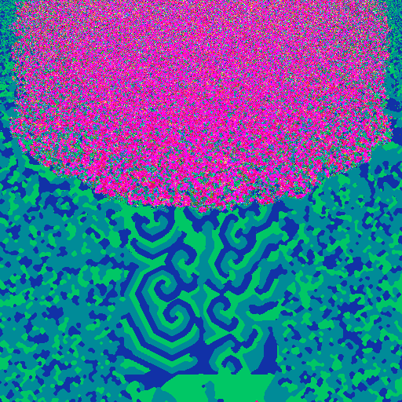 | 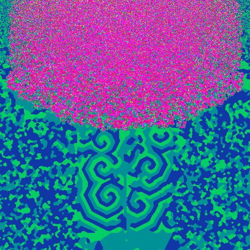 | 0.23 / 0.24 / 0.24 (0.23) |
| Archipelago (`ca-live-archipelago`) | 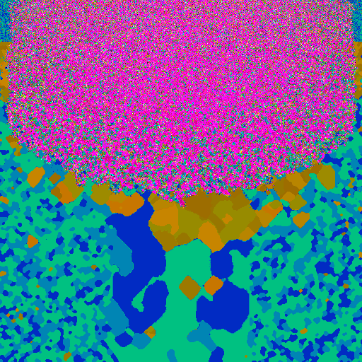 | 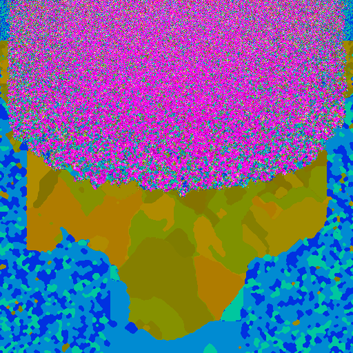 | 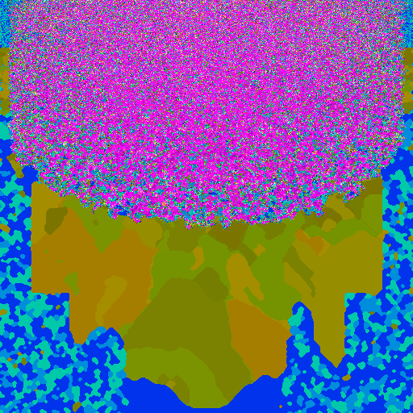 | 0.16 / 0.02 / 0.01 (0.00) |
| Coast (`ca-live-coast`) | 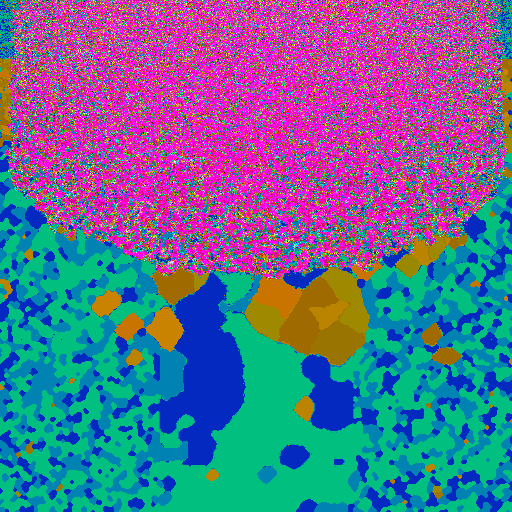 | 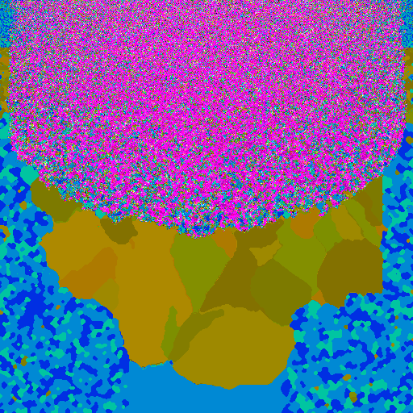 | 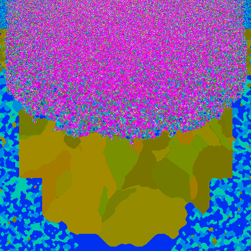 | 0.13 / 0.02 / 0.01 (0.00) |
| Reef (`ca-live-reef`) | 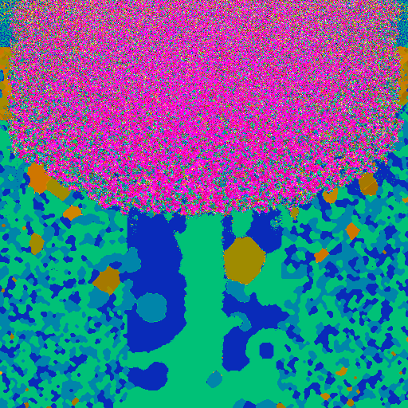 | 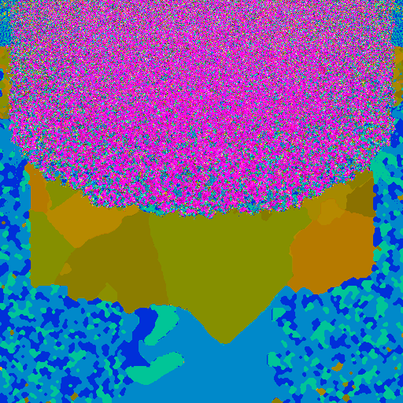 | 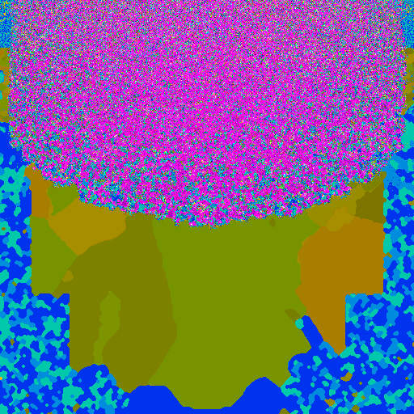 | 0.18 / 0.05 / 0.02 (0.02) |
| Lagoon (`ca-live-lagoon`) | 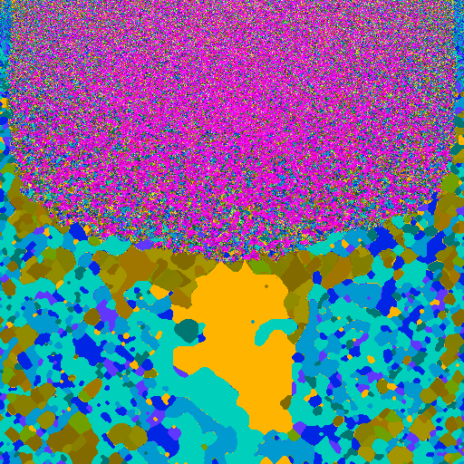 | 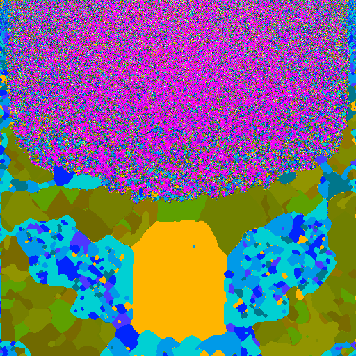 | 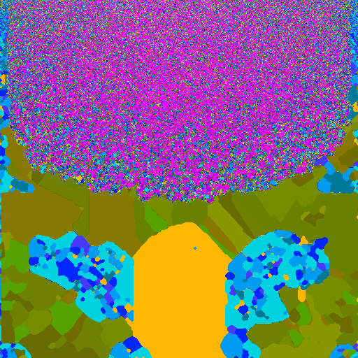 | 0.11 / 0.10 / 0.10 (0.06) |
| Swarm search F (reference) (`ca-swarm-f`) | 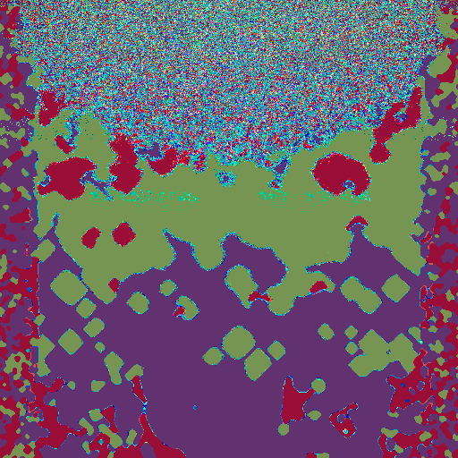 | 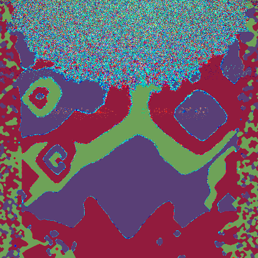 | 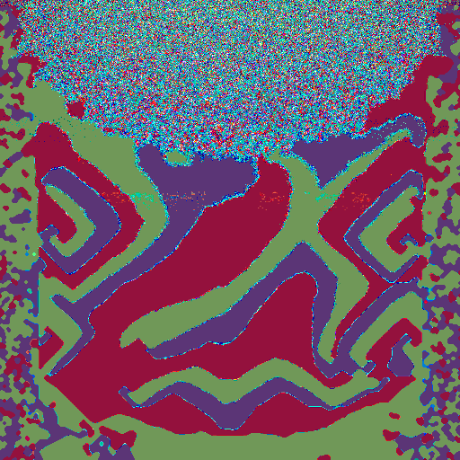 | 0.22 / 0.37 / 0.44 (0.51) |
| Twenty Gray 8-cycles (reference) (`ca-gray20c`) | 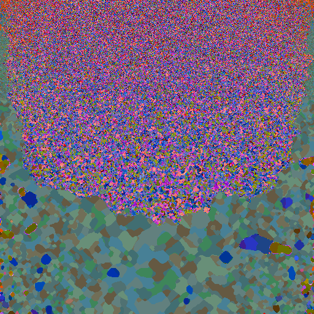 | 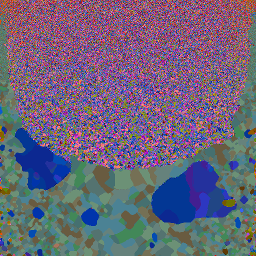 | 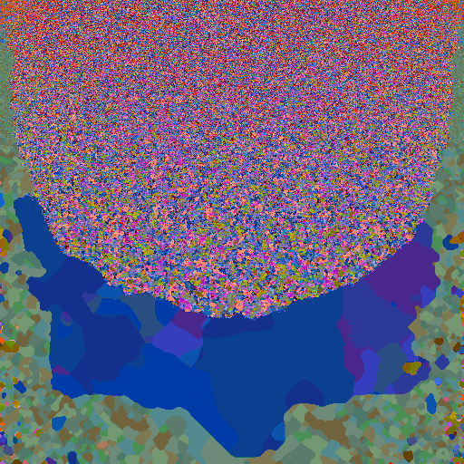 | 0.16 / 0.13 / 0.06 (0.03) |
